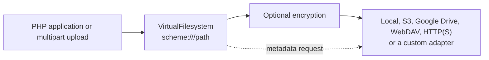

# Simple VirtualFS

[](https://packagist.org/packages/richie314/simple-virtualfs)
[](https://packagist.org/packages/richie314/simple-virtualfs)

[](LICENSE)

A PHP 8.3+ Composer library for named storage locations, client-side file encryption, and PDF and image manipulation.
Each `VirtualFilesystem` instance owns its mounts.
Pass virtual paths to the package methods using `scheme:///relative/path`.

## Install

From your application directory, install the package from Packagist.

```sh
composer require richie314/simple-virtualfs
```

Load `vendor/autoload.php` in your application.
Local, S3-compatible, Google Drive, WebDAV and read-only HTTP/HTTPS support come with the package.



## Quick start

```php
require 'vendor/autoload.php';

use Richie314\SimpleVirtualFS\VirtualFilesystem;

$files = new VirtualFilesystem();
$files->mountLocal('local', '/srv/virtual-files'); // Existing directory.

$files->write('local:///reports/summary.txt', 'February report');
echo $files->read('local:///reports/summary.txt');
```

<details>
<summary>Mount an S3-compatible bucket and copy a file into it</summary>

```php
use Aws\S3\S3Client;

$s3 = new S3Client([
    'version' => 'latest',
    'region' => 'us-east-1',
    'endpoint' => 'https://storage.example.com', // Omit for AWS S3.
    'use_path_style_endpoint' => true, // Enable if the endpoint needs it.
    // Credentials come from the AWS SDK credential chain.
]);
$files->mountS3('app', $s3, 'documents', prefix: 'demo', name: 'Main application storage');
// For an AWS bucket with Bucket owner enforced, pass options: ['ACL' => 'bucket-owner-full-control'].

$files->copy('local:///reports/summary.txt', 'app:///archive/summary.txt');
echo $files->read('app:///archive/summary.txt');
```

</details>

The file API also provides `exists`, `delete`, `move`, `size`, `mimeType` and `createDirectory`.
Write and copy can replace an existing destination.
Move writes the destination before deleting the source and can leave both files if deletion fails.
Coordinate moves with concurrent writers and use distinct backing paths for mounted locations.
`size` returns plaintext bytes for a configured encrypted file, while directory listings report backing storage metadata.

Schemes are case-insensitive.
Path segments use literal, unescaped UTF-8.
Use forward slashes and omit dot segments, empty segments, control characters and the reserved characters `\`, `:`, `%`, `?` and `#`.
Use a dedicated local root controlled by your application.
The local mount rejects symlinks in requested paths and skips symlinks in listings.
The directory tree needs to be protected from concurrent changes by untrusted local processes.

## List configured storage

Give any mount a display name with the optional `name` argument.
The default display name is its root URI.

```php
$files->mountLocal('reports', '/srv/reports', name: 'Generated reports');
foreach ($files->listMounts() as $mount) {
    echo $mount['scheme'], ':/// — ', $mount['name'], ' (', $mount['type'], ')', PHP_EOL;
}
```

Built-in types are `local`, `s3`, `google-drive`, `webdav`, `http` and `https`.
For a custom adapter, pass `type` to `mount()` or use its default adapter class name.

## Google Drive

1. In Google Cloud, create a project, enable the **Google Drive API**, and configure the OAuth consent screen.
   For an external app in Testing, add the Drive account as a test user.
2. Create a **Web application** OAuth client.
   Copy its client ID and secret.
   To obtain a token with Google's OAuth Playground, add `https://developers.google.com/oauthplayground` to its authorized redirect URIs.
3. In the Playground settings, enable **Use your own OAuth credentials** and enter the ID and secret.
   Request offline access and authorize with the Drive account.
   Choose a scope that covers the target folder and operations.
   For example, `https://www.googleapis.com/auth/drive` allows reading and writing existing files the account can access.
   Exchange the authorization code for tokens and save the **refresh token**.
4. Set `GOOGLE_CLIENT_ID`, `GOOGLE_CLIENT_SECRET` and `GOOGLE_REFRESH_TOKEN` in your application's secret configuration.
   Use the Drive folder path as the third argument to `mountGoogleDrive`, or `/` for the configured Drive root.
   For a shared folder, copy the ID from the part after `/folders/` in its Drive URL and pass it as `sharedFolderId`.

[Google OAuth setup](https://developers.google.com/identity/protocols/oauth2/web-server) · [OAuth Playground](https://developers.google.com/oauthplayground/) · [Drive scopes](https://developers.google.com/workspace/drive/api/guides/api-specific-auth)

<details>
<summary>Connect with a refresh token</summary>


```php
$client = new \Google\Client();
$client->setClientId((string) getenv('GOOGLE_CLIENT_ID'));
$client->setClientSecret((string) getenv('GOOGLE_CLIENT_SECRET'));
$token = $client->fetchAccessTokenWithRefreshToken((string) getenv('GOOGLE_REFRESH_TOKEN'));
if (isset($token['error'])) {
    throw new RuntimeException('Google Drive authorization failed.');
}

$files->mountGoogleDrive('drive', new \Google\Service\Drive($client), 'My_App_Root');
$files->copy('app:///archive/summary.txt', 'drive:///summary.txt');
```

</details>

Pass the Drive adapter's `sharedFolderId` or `teamDriveId` options where needed.
Use unique file and folder names within each directory because Drive permits duplicate names and the adapter resolves by path.
The mount is intended for ordinary uploaded files such as PDFs and images.
[Google Drive adapter setup and limitations](https://github.com/masbug/flysystem-google-drive-ext)

## WebDAV

Pass a configured Sabre client.
Use the server's WebDAV directory URL, with a trailing slash, as `baseUri`.

```php
$client = new \Sabre\DAV\Client([
    'baseUri' => 'https://dav.example.com/files/',
    'userName' => (string) getenv('DAV_USERNAME'),
    'password' => (string) getenv('DAV_PASSWORD'),
]);
$files->mountWebDav('partner', $client);
$files->copy('local:///reports/summary.txt', 'partner:///incoming/summary.txt');
```

## HTTP and HTTPS

Use `mountHttp()` with a Guzzle client configured for your endpoint.
Include a trailing slash in the base URI when mounting a directory.
HTTP and HTTPS mounts provide read-only access to known file paths, such as assets on an internal web server or CDN.
The bundled HTTP adapter uses Guzzle 7.
Use WebDAV for remote writes and directory listings. [HTTP adapter documentation](https://github.com/ntzrbtr/flysystem-http)

```php
$http = new \GuzzleHttp\Client([
    'base_uri' => 'https://example.com/downloads/',
    'allow_redirects' => false,
    'timeout' => 30,
]);
$files->mountHttp('public', $http, name: 'Public downloads');
$files->copy('public:///guide.pdf', 'local:///guide.pdf');
```

## Optional adapters for FTP, SFTP and OneDrive

Use `mount($scheme, $adapter, key: $key)` with any Flysystem 3 adapter.
Install only the optional adapters you use.

| Transport | Composer package | Adapter setup |
| --- | --- | --- |
| FTP or FTPS | `league/flysystem-ftp` | [FTP connection options](https://flysystem.thephpleague.com/docs/adapter/ftp/) |
| SFTP | `league/flysystem-sftp-v3` | [SFTP connection provider and host fingerprint](https://flysystem.thephpleague.com/docs/adapter/sftp-v3/) |
| OneDrive | `leapt/flysystem-onedrive:^1.1` | [OneDrive adapter and Graph authentication](https://github.com/leapt/flysystem-onedrive) |

<details>
<summary>Configure an FTPS mount</summary>

```sh
composer require league/flysystem-ftp:^3.0
```

```php
$files->mount('archive', new \League\Flysystem\Ftp\FtpAdapter(
    \League\Flysystem\Ftp\FtpConnectionOptions::fromArray([
        'host' => 'ftp.example.com',
        'root' => '/archive',
        'username' => (string) getenv('FTP_USERNAME'),
        'password' => (string) getenv('FTP_PASSWORD'),
        'ssl' => true,
    ]),
));
$files->copy('local:///guide.pdf', 'archive:///guide.pdf');
```

</details>

<details>
<summary>Mount Microsoft OneDrive</summary>

```sh
composer require leapt/flysystem-onedrive:^1.1
```

Provide a Microsoft Graph access token authorized for the target drive and operations.
Refresh the token through your Microsoft authentication setup when it expires.

```php
$graph = new \Microsoft\Graph\Graph();
$graph->setAccessToken((string) getenv('ONEDRIVE_ACCESS_TOKEN'));
$adapter = new \Leapt\FlysystemOneDrive\OneDriveAdapter($graph);
$files->mount('drive-ms', $adapter, name: 'OneDrive documents', type: 'onedrive');
$files->copy('local:///guide.pdf', 'drive-ms:///guide.pdf');
```

</details>

## List virtual folder contents

Pass a mount root or a folder URI to `listContents()`.
The default lists immediate files and folders.
Set `recursive: true` to include descendants.
Listing retrieves directory entries without reading file bodies, including on encrypted mounts.
Each entry has a mount-relative `path()` and methods to identify its type.
Directory listing support depends on the adapter. [Flysystem directory listings](https://flysystem.thephpleague.com/docs/usage/directory-listings/)

```php
foreach ($files->listContents('app:///') as $entry) {
    echo $entry->isDir() ? '[folder] ' : '[file] ', $entry->path(), PHP_EOL;
}

foreach ($files->listContents('app:///archive', recursive: true) as $entry) {
    if ($entry->isFile()) {
        echo 'app:///', $entry->path(), PHP_EOL;
    }
}
```

## Inspect a file without downloading it

`metadata($uri)` returns the stored size in bytes and last modification time as a Unix timestamp in seconds.
S3, Google Drive and WebDAV use the server's MIME metadata when available.
Other adapters default to an extension-based MIME estimate, with `application/octet-stream` for unknown extensions.
A custom mount may opt into server MIME with `serverMimeType: true` when the adapter can fetch it without reading the body.
Metadata uses the adapter's size and timestamp operations and may make several requests.
It throws if the backend cannot supply size or modification time.

```php
$info = $files->metadata('partner:///incoming/summary.txt');
echo $info['mimeType'], PHP_EOL;
echo $info['size'], ' bytes', PHP_EOL;
echo gmdate(DATE_ATOM, $info['lastModified']), PHP_EOL;
```

Encrypted files report ciphertext size and `application/octet-stream`.
Use `size()` or `mimeType()` when you need plaintext information and can read the file.

## Save a PHP upload

Use a multipart POST form.
The helper checks PHP's upload status and verifies that the temporary file belongs to the current request.
It applies the destination's encryption settings and can replace an existing file.
Choose destination names on the server and apply your application's file size and content rules before saving.

```php
$upload = $_FILES['document'] ?? null;
if ($upload !== null && $upload['error'] !== UPLOAD_ERR_NO_FILE) {
    $id = bin2hex(random_bytes(16));
    $files->saveUpload($upload, "local:///incoming/$id");
}
```

<details>
<summary>Save multiple files from an attachments[] field</summary>

```php
use Richie314\SimpleVirtualFS\UploadedFiles;

foreach (UploadedFiles::fromField($_FILES['attachments'] ?? null) as $upload) {
    if ($upload['error'] === UPLOAD_ERR_NO_FILE) {
        continue;
    }
    $id = bin2hex(random_bytes(16));
    $files->saveUpload($upload, "app:///incoming/$id");
}
```

Each file is saved individually.
To present a PHP upload error to the caller, catch the exception from `saveUpload()` and inspect its code.

</details>

## Encryption

Simple VirtualFS encrypts content in PHP before sending it to storage and authenticates and decrypts it during reads.
It uses libsodium XChaCha20-Poly1305 with a fresh random nonce on every write.
The storage adapter receives ciphertext, while the key stays in your application.
File names, folder listings, modification times and stored sizes remain visible.

Generate each key once with `base64_encode(random_bytes(32))` and save the encoded value in a local secret store or protected environment configuration.
Decode the value before passing the 32 raw bytes to the library.
Load the same keys whenever you recreate the filesystem.

### Encrypt an entire storage source

Pass `key:` when registering the mount to encrypt every file written there through Simple VirtualFS.
This example uses the S3 client from the quick start and a dedicated prefix for encrypted files.

```php
$sourceKey = sodium_base642bin(
    (string) getenv('VFS_ARCHIVE_KEY'),
    SODIUM_BASE64_VARIANT_ORIGINAL,
);

$files->mountS3('secure', $s3, 'documents', prefix: 'encrypted', key: $sourceKey, name: 'Encrypted archive');
$files->write('secure:///summary.txt', 'Confidential report');
echo $files->read('secure:///summary.txt');
```

### Encrypt one file with its own key

Use `setFileKey()` before reading or writing the exact virtual URI.
It can enable encryption for one file on a plaintext mount or override the key on an encrypted mount.
Here, the contract uses its own key while the rest of the `secure:///` mount uses the source key.

```php
$fileKey = sodium_base642bin(
    (string) getenv('VFS_CONTRACT_KEY'),
    SODIUM_BASE64_VARIANT_ORIGINAL,
);

$files->setFileKey('secure:///contracts/agreement.txt', $fileKey);
$files->write('secure:///contracts/agreement.txt', 'Confidential agreement');
echo $files->read('secure:///contracts/agreement.txt');
```

Passing `null` to `setFileKey()` clears the override for future operations.
An existing encrypted file still needs the key used to write it.

### Move or migrate encrypted files

Ciphertext is authenticated against the virtual URI, so keep its scheme and path stable across restarts.
Use `copy()` or `move()` to relocate a file so it is read with the source key and rewritten using the destination's key policy.
Changing a key requires reading with the old key and rewriting with the new key.
To enable encryption for existing unencrypted files, copy them from their original mount into a separate encrypted mount and verify that they can be read there before switching over.

## PDFs and images

```php
$media = new \Richie314\SimpleVirtualFS\Media($files);
$media->mergePdfs(['local:///first.pdf', 'drive:///second.pdf'], 'app:///merged.pdf');
$media->imagesToPdf(['local:///front.jpg', 'local:///back.png'], 'app:///scan.pdf');
$media->downscaleImage('local:///photo.jpg', 'app:///photo-small.jpg', 1600, 1600, quality: 80);
```

Sources and destinations use the same virtual path API and encryption settings.
PDF merge preserves page order and dimensions.
Some PDFs require the commercial FPDI parser, and interactive PDF content such as forms and bookmarks is omitted.
[FPDI limitations](https://manuals.setasign.com/fpdi-manual/v2/limitations/)

Image helpers accept JPEG, PNG and WebP when supported by the PHP GD build.
Images-to-PDF creates one A4 page per image and uses short-lived local temporary image files.
Downscaling preserves aspect ratio and format, skips upscaling, and treats quality as the JPEG or WebP encoder setting.
Smaller dimensions can still result in a larger encoded file.
File reads, uploads, encryption, transfers and media processing buffer whole files, so size workload limits to available memory.

In a source checkout, run `composer install` and `composer test` for the smoke test.

Try both remote backends locally using the [Docker Compose demo](demo/README.md) from the source checkout.

## Testing and releasing

GitHub Actions runs the Composer validation, PHP syntax checks and smoke tests in Docker on PHP 8.3, 8.4 and 8.5.
The smoke tests use local storage and need no cloud credentials.

To enable publishing, submit the public repository to Packagist once and add the `PACKAGIST_USERNAME` and `PACKAGIST_API_TOKEN` repository secrets.
Use a Packagist account with update access to `richie314/simple-virtualfs`. [Packagist publishing and API setup](https://packagist.org/about#how-to-update-packages)

Run **Test and release** from the repository's Actions tab with a new stable version such as `1.2.3`.
After all PHP versions pass, the workflow tags the tested commit as `v1.2.3`, creates a GitHub release, and asks Packagist to refresh the package.
If only the Packagist update fails, fix the credentials or package registration and use **Re-run failed jobs** to retry the update.

## License

This package is available under the [MIT License](LICENSE).
Dependencies are distributed under their own licenses.
